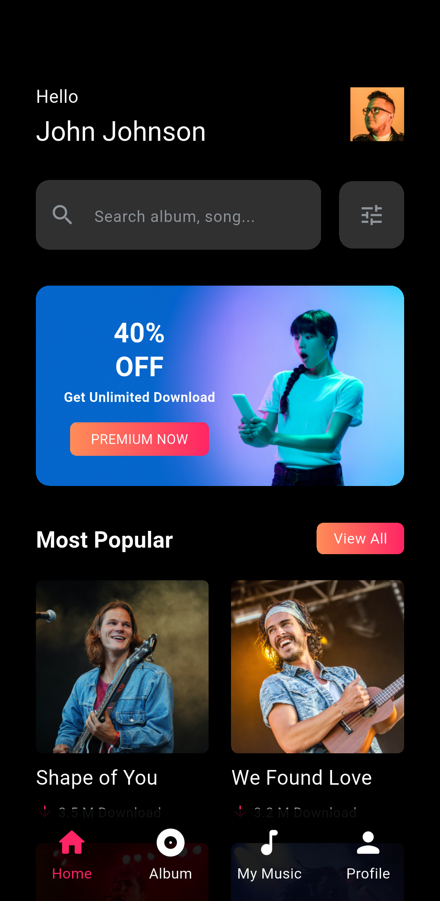
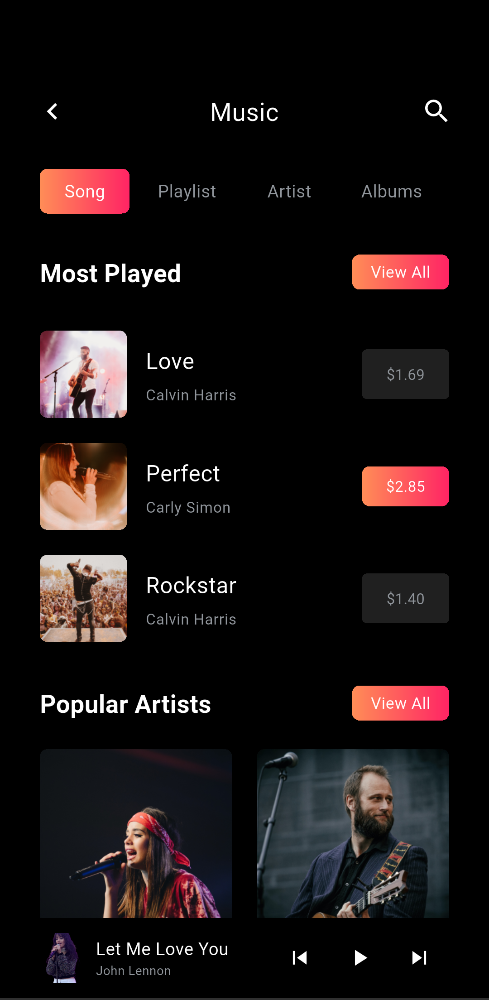
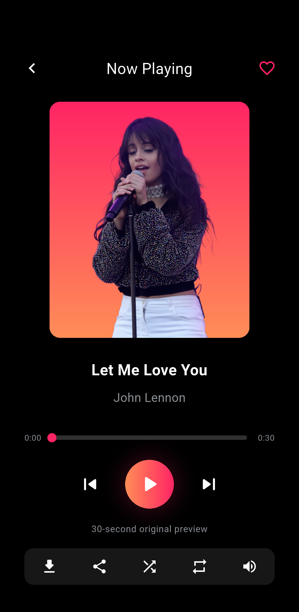
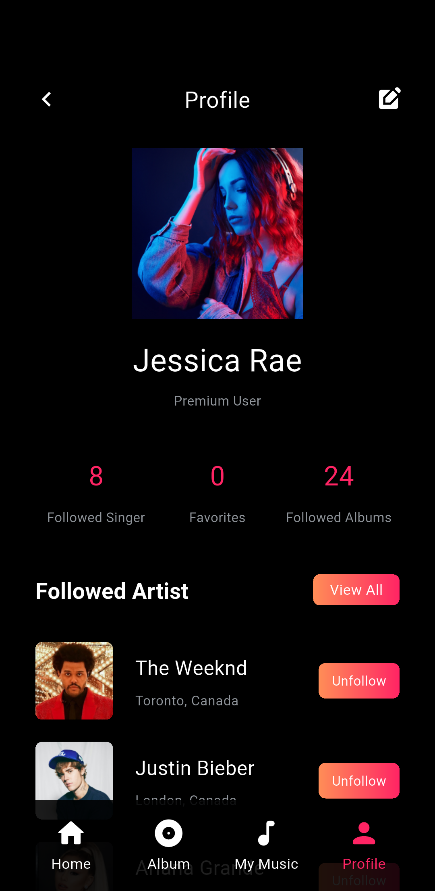
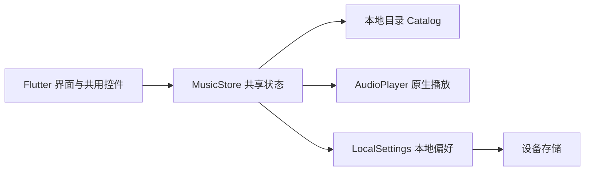

# Music · Flutter 音乐应用

基于当前 Pixso 参考文件实现的原生 Flutter 应用。已完整枚举文件中的页面分类：当前文件只有 `Page 1`，其中包含 **19 个移动端界面**。保留黑色背景、珊瑚橙至玫红渐变、Roboto 字体以及原稿中的图片素材。

应用由真实 Flutter 控件组成，支持页面跳转、搜索、收藏、关注、表单校验、播放控制与本地偏好保存。所有图片、字体和试听音频均随应用打包，运行时无需访问素材服务器。

## 主要界面

下图为 Android 模拟器中运行本项目得到的实际界面，原始参考图单独保存在 `docs/design_reference/`。

| 首页 | 音乐库 | 播放器 | 个人中心 |
| --- | --- | --- | --- |
|  |  |  |  |

[查看全部 19 个界面截图](docs/SCREENSHOTS.md) · [查看架构与页面映射](docs/ARCHITECTURE.md) · [查看验证记录](docs/TEST_REPORT.md)

## 快速运行

验证环境：Flutter **3.41.6**、Dart **3.11.4**、Android 14 / API 34 模拟器。

```sh
flutter pub get
flutter run
```

Android 调试安装包构建：

```sh
flutter build apk --debug
```

输出：`build/app/outputs/flutter-apk/app-debug.apk`。

体积更小的 ARM64 Android 体验包：

```sh
flutter build apk --release --split-per-abi --target-platform android-arm64 -t lib/main.dart
```

输出：`build/app/outputs/flutter-apk/app-arm64-v8a-release.apk`，使用项目默认的本地测试签名。

项目包含 Android、iOS 和 Web 工程。iOS 工程需要在安装相应运行时并配置签名的 Mac 上构建；本次实际运行验证使用 Android 模拟器。

## 体验流程

- 首次启动：引导页 → 登录；默认演示邮箱为 `jessicarae@gmail.com`，密码预填 `music123`，也可输入任意格式正确的邮箱和不少于 6 位的密码。
- 注册：填写用户名、邮箱和密码 → 验证码 → 语言偏好 → 首页。演示验证码为 **5724**，有效期 25 秒，可以重新获取。
- 找回密码：邮箱 → 验证码 → 设置并确认新密码 → 返回登录。
- 音乐探索：首页搜索或分类 → 歌曲 → 播放器。支持播放/暂停、进度拖动、上一首/下一首、收藏、随机、单曲循环、静音和保存试听。
- 我的音乐：`View All` 中可筛选全部、收藏和已保存试听；个人中心的收藏统计也可直接进入收藏列表。
- 个人中心右上角进入设置，可修改显示名、选择语言、切换通知偏好、查看卡片及隐私说明、保存本地反馈或退出登录。

## 项目结构与架构

采用小型分层结构：界面负责展示，共享状态负责交互，数据层负责目录与本地保存。使用 Flutter 自带的 `ChangeNotifier` / `InheritedNotifier`，无需额外状态管理框架。

```text
lib/
├── main.dart                     # 初始化系统样式、恢复偏好、启动应用
├── app.dart                      # 19 个命名路由
├── core/
│   ├── app_theme.dart            # 色彩、字体、输入框与主题
│   └── music_store.dart          # 播放、收藏、关注、用户偏好状态
├── data/
│   ├── catalog.dart              # 歌曲、歌手、分类与语言示例数据
│   └── local_settings.dart       # 本地设置读写
├── screens/
│   ├── auth_screens.dart         # 引导、登录、注册、验证码、找回/重设密码
│   ├── browse_screens.dart       # 首页、即将上线、音乐库、歌手与分类
│   ├── player_screen.dart        # 播放器
│   └── account_screens.dart      # 个人中心、关注、设置、语言、卡片与隐私
└── widgets/
    └── music_widgets.dart        # 页面骨架、导航、渐变按钮、封面、列表与搜索
assets/
├── images/                       # 从 Pixso 导出的局部图片素材
├── fonts/                        # Roboto 字体及许可证
├── branding/                     # 应用图标源图
└── audio/preview.wav             # 原创 30 秒演示音频
integration_test/                 # Android 逐页截图与真实播放验证
test/                             # 布局、状态和登录测试
test_driver/                      # 截图保存到本机的驱动
docs/                             # 架构、截图、参考图和验证记录
```



## 演示边界

账户登录、第三方登录、验证码、密码重设和支付均为**本地演示流程**，未接入服务器、OAuth、邮件服务或支付网关；不会发送邮件或扣费。密码和验证码不会保存。`Remember me` 仅决定下次启动是否保留演示登录状态。

所有歌曲播放同一段随应用打包的原创 30 秒试听音频；显示的歌名和图片用于还原设计，不代表提供对应商业歌曲。保存试听记录是对已打包音频的本地标记。

语言选择保存偏好，本次 UI 内容保持参考稿中的英文；通知选项保存本地开关，未连接推送服务。卡片使用固定脱敏样例。隐私页面按本应用实际行为撰写，并补充密码确认、错误提示、空状态及演示说明。

## 验证与重新截图

```sh
flutter analyze
flutter test
flutter drive --driver=test_driver/integration_test.dart \
  --target=integration_test/app_test.dart -d emulator-5554
```

截图会写入 `docs/screenshots/`。截图驱动直接运行真实 Flutter 应用；Android 原生截图出现短暂取帧失败时会等待新帧并重试。

直接运行依赖仅使用 [audioplayers](https://pub.dev/packages/audioplayers) 和 [shared_preferences](https://pub.dev/packages/shared_preferences)。已删除 Pixso 自动生成的整页图片展示代码、未用辅助类和占位示例测试，统一复用页面、导航、按钮、列表项和搜索组件。
