# 全部界面截图

以下 19 张 PNG 均由 Android 模拟器运行本项目后通过 Flutter 集成测试截取，保留原始输出尺寸。图片展示初始视口；列表、表单和隐私内容可继续滚动。

[返回项目说明](../README.md) · [项目架构](ARCHITECTURE.md)

## 界面总览

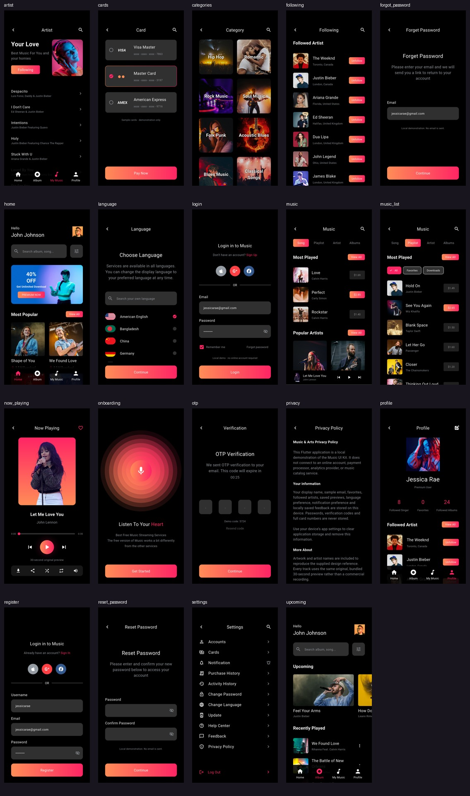

## 单页截图

| 界面 | 实际应用截图 | Pixso 参考 |
| --- | --- | --- |
| 引导 · `onboarding` | <a href="screenshots/onboarding.png">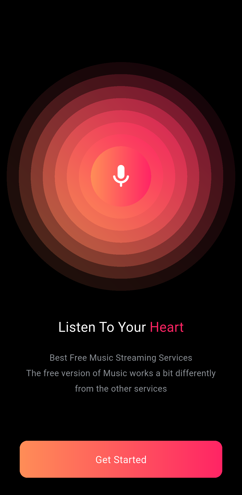</a> | [原始参考](design_reference/onboarding.png) |
| 登录 · `login` | <a href="screenshots/login.png">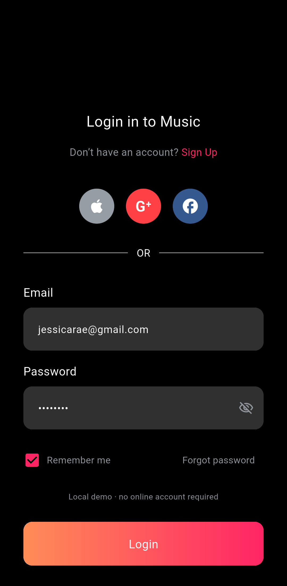</a> | [原始参考](design_reference/login.png) |
| 注册 · `register` | <a href="screenshots/register.png">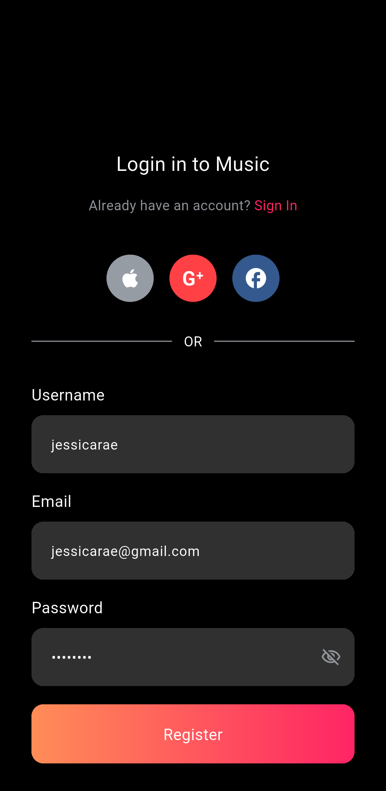</a> | [原始参考](design_reference/register.png) |
| 验证码 · `otp` | <a href="screenshots/otp.png">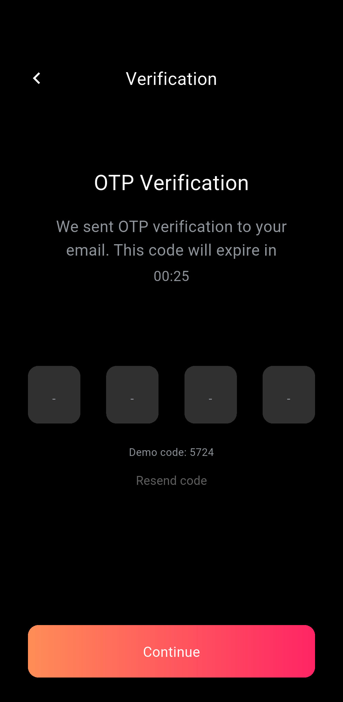</a> | [原始参考](design_reference/otp.png) |
| 找回密码 · `forgot_password` | <a href="screenshots/forgot_password.png">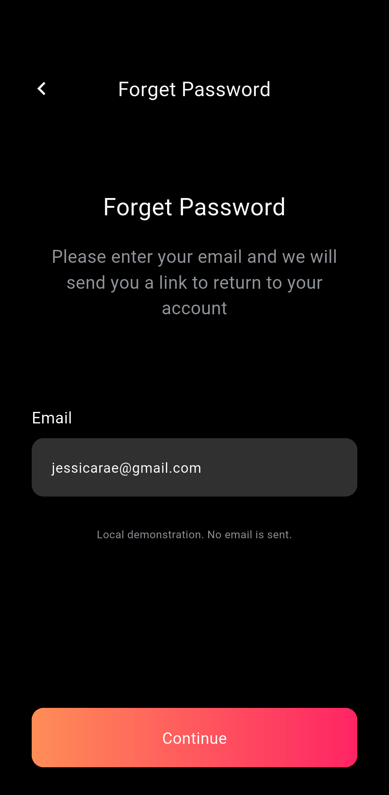</a> | [原始参考](design_reference/forgot_password.png) |
| 重设密码 · `reset_password` | <a href="screenshots/reset_password.png">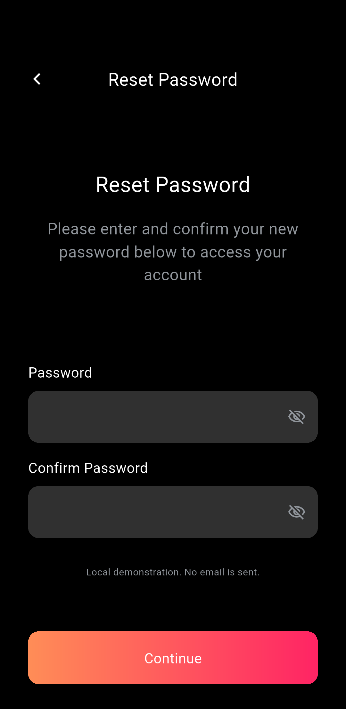</a> | [原始参考](design_reference/reset_password.png) |
| 首页 · `home` | <a href="screenshots/home.png">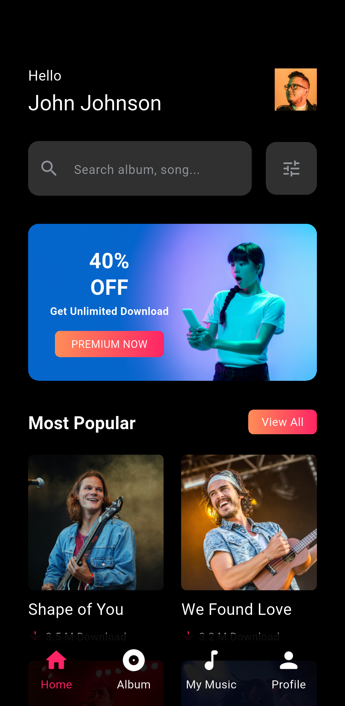</a> | [原始参考](design_reference/home.png) |
| 即将上线与最近播放 · `upcoming` | <a href="screenshots/upcoming.png">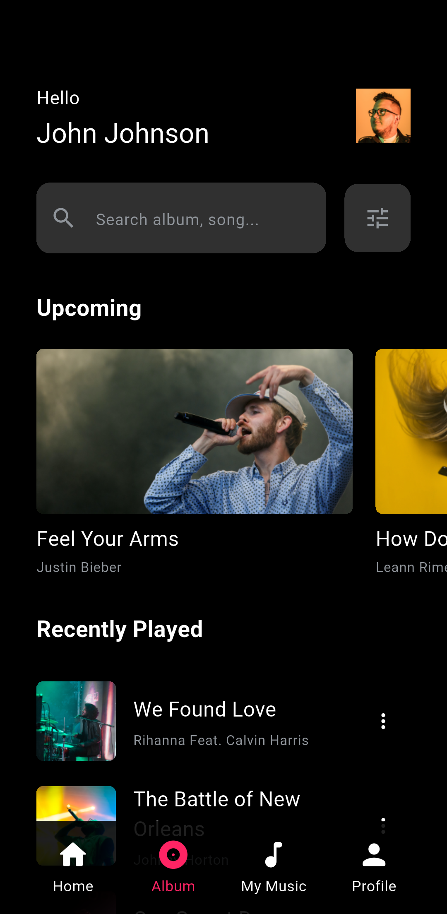</a> | [原始参考](design_reference/upcoming.png) |
| 音乐库 · `music` | <a href="screenshots/music.png">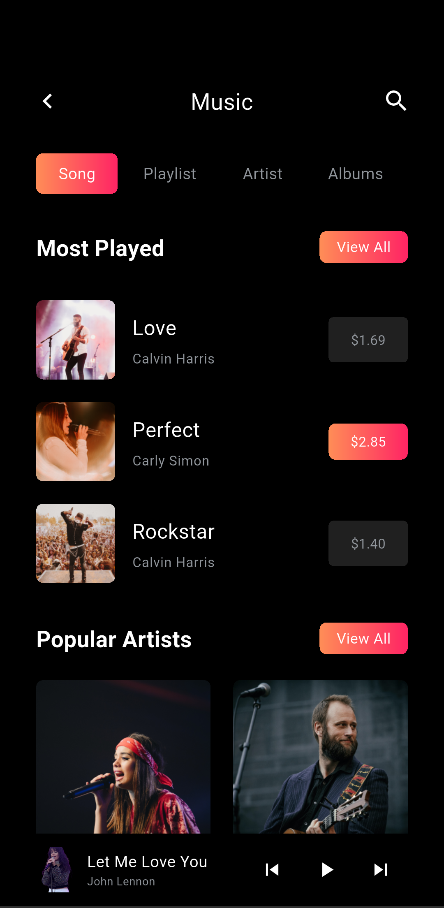</a> | [原始参考](design_reference/music.png) |
| 播放列表与筛选 · `music_list` | <a href="screenshots/music_list.png">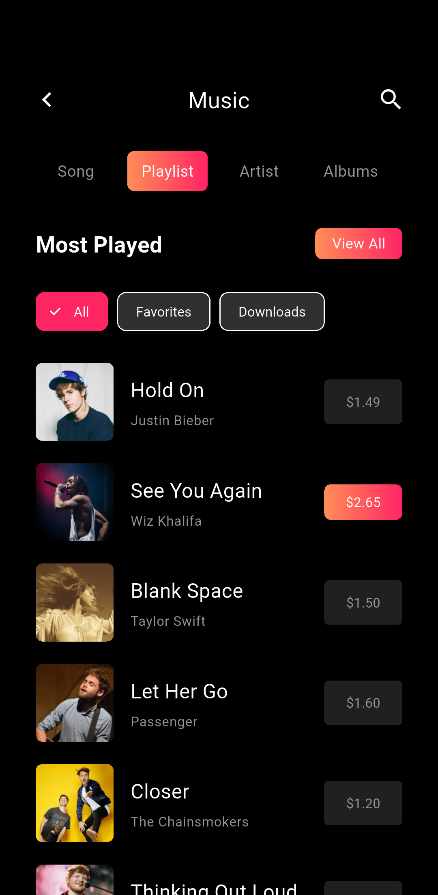</a> | [原始参考](design_reference/music_list.png) |
| 歌手详情 · `artist` | <a href="screenshots/artist.png">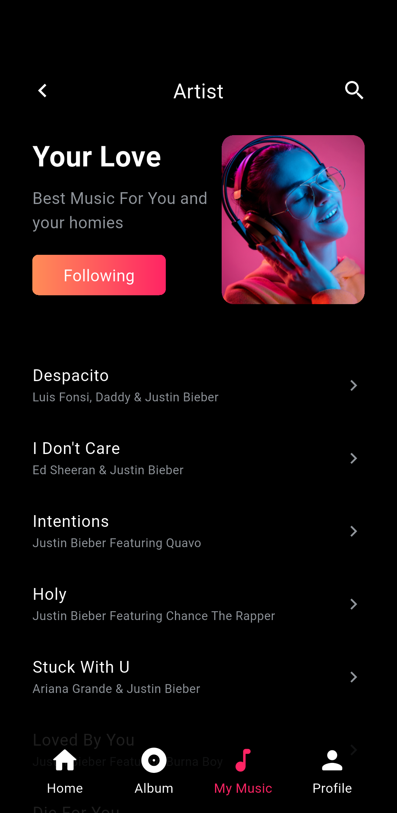</a> | [原始参考](design_reference/artist.png) |
| 正在播放 · `now_playing` | <a href="screenshots/now_playing.png">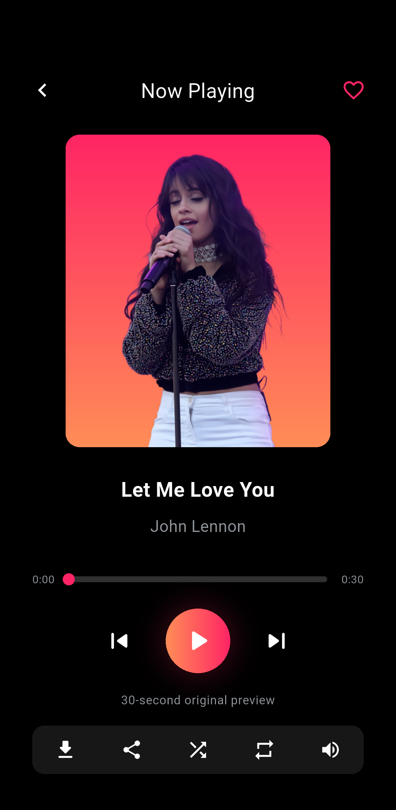</a> | [原始参考](design_reference/now_playing.png) |
| 音乐分类 · `categories` | <a href="screenshots/categories.png">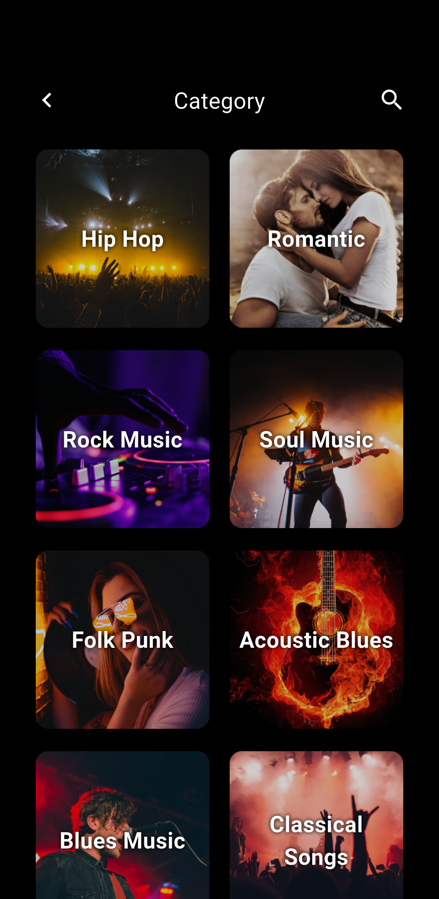</a> | [原始参考](design_reference/categories.png) |
| 个人中心 · `profile` | <a href="screenshots/profile.png">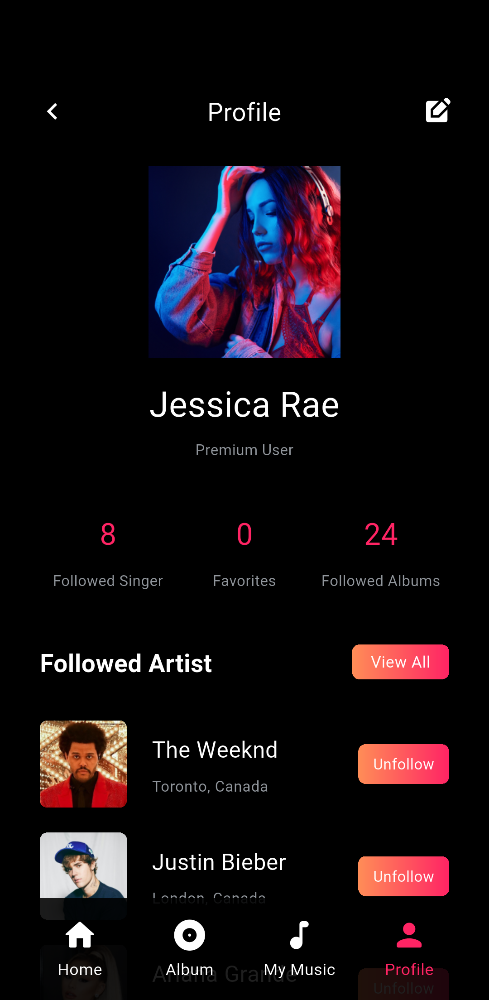</a> | [原始参考](design_reference/profile.png) |
| 关注歌手 · `following` | <a href="screenshots/following.png">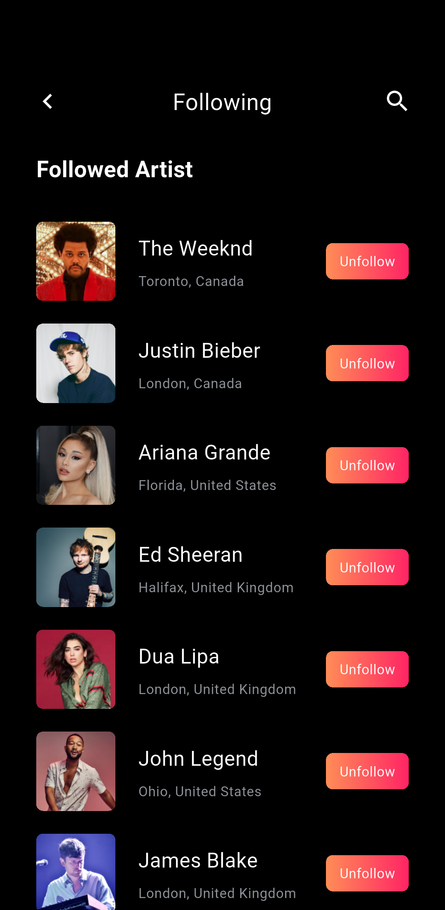</a> | [原始参考](design_reference/following.png) |
| 设置 · `settings` | <a href="screenshots/settings.png">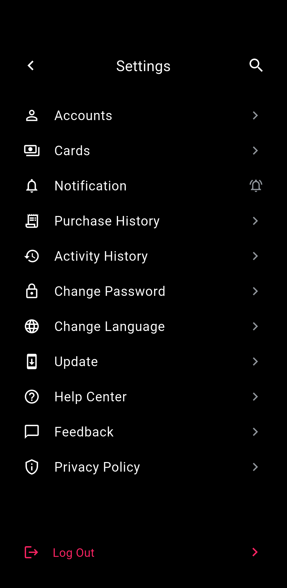</a> | [原始参考](design_reference/settings.png) |
| 语言偏好 · `language` | <a href="screenshots/language.png">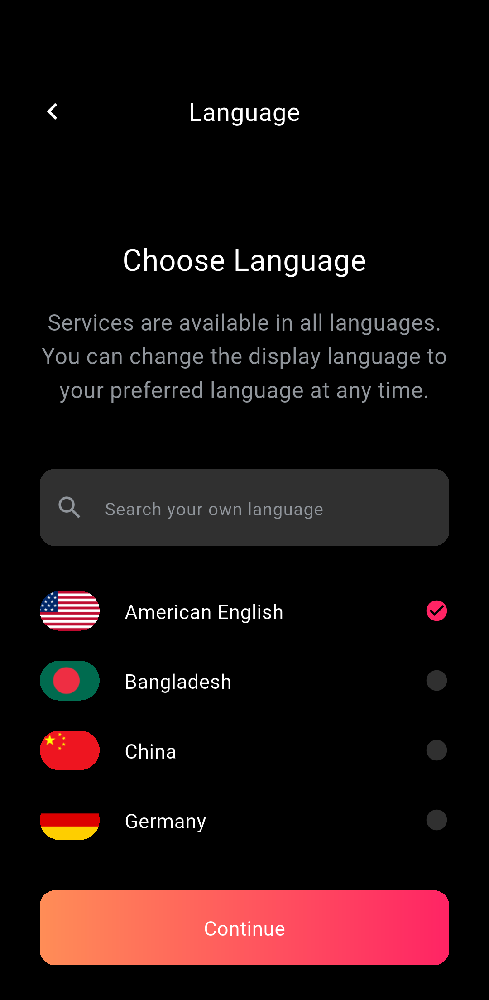</a> | [原始参考](design_reference/language.png) |
| 卡片 · `cards` | <a href="screenshots/cards.png">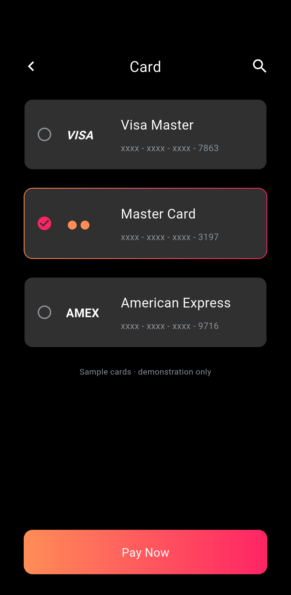</a> | [原始参考](design_reference/cards.png) |
| 隐私说明 · `privacy` | <a href="screenshots/privacy.png">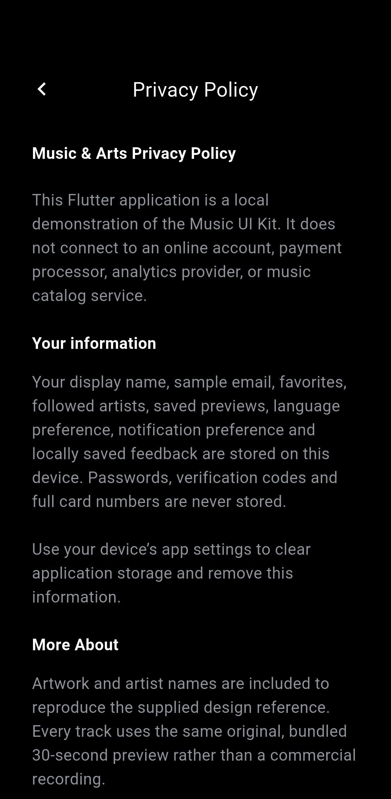</a> | [原始参考](design_reference/privacy.png) |

## 重新生成

```sh
flutter drive --driver=test_driver/integration_test.dart \
  --target=integration_test/app_test.dart -d emulator-5554
```

截图脚本会预先解码本地图片后再取帧，避免快速切换到懒加载网格时截到尚未显示的封面。截图保持演示初始状态，未播放音频，也未输入真实账户或支付信息。
